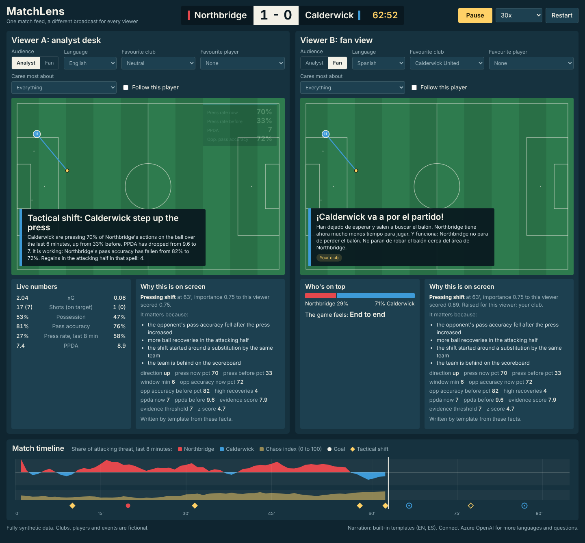
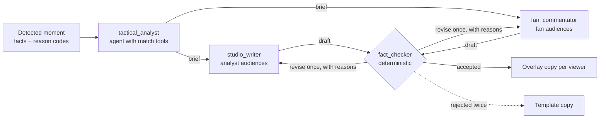

# MatchLens

One synthetic football match feed in, a different broadcast out for every viewer.

MatchLens ingests match events as they happen, works out which moments matter and why, and renders that as timed overlay graphics. The same intelligence reaches an analyst as numbers and tactical terms, and a casual fan as two plain sentences in their language about their club.



**[Watch the 2-minute demo](https://www.youtube.com/watch?v=BM85OdtaQu8)** · **[Try it live](https://matchlens.greenmoss-a99bb9ec.eastus2.azurecontainerapps.io)**

Everything in this repository is synthetic. The clubs, players and events are fictional and generated by the code in `matchlens/synth`.

## Run it

Requires Python 3.11 or newer (developed and tested on 3.13).

```bash
python -m venv .venv
source .venv/bin/activate            # Windows: .venv\Scripts\activate
pip install -r requirements-dev.txt
python -m matchlens serve            # open http://127.0.0.1:8000
```

Press **Play**. Select a marker on the timeline to jump to a goal or tactical shift. Change the audience, language, favourite club or favourite player on either viewer and the overlays change with it.

No cloud account is needed for any of that: without a model, every overlay is written from templates.

To turn on the agent desk (Microsoft Agent Framework on a Microsoft Foundry model), more languages and the "Ask about the match" box:

```bash
cp .env.example .env                 # fill in FOUNDRY_PROJECT_ENDPOINT and FOUNDRY_MODEL
az login
python -m matchlens check            # one live run of the desk on the first goal
python -m matchlens warm             # optional: pre-write copy for the demo viewers so replays are instant
python -m matchlens serve
```

Other commands:

```bash
python -m matchlens run --profile analyst:en --profile fan:es:CAL     # print each viewer's overlay copy
python -m matchlens run --agents --profile fan:fr:CAL                  # same, written by the agent desk
python -m matchlens export --profile fan:es:CAL --format vtt > fan.vtt  # overlay track as WebVTT
python -m matchlens generate --seed 42 --name my_match                 # write a new synthetic match
python scripts/eval_detectors.py                                       # score detectors against ground truth
pytest                                                                 # 94 tests, no network needed
```

To feed the viewer live through Azure Event Hubs instead of the recorded file, set `EVENTHUB_NAMESPACE` in `.env`, run `serve`, pick **Live: Event Hubs** in the viewer, and in a second terminal start the feed:

```bash
python -m matchlens publish --speed 30   # stands in for the data provider: sends each event as it happens
```

## The pipeline

```
 events.jsonl ─► INGEST ─► INTERPRET ─► DETECT ─► PERSONALIZE ─► EXPLAIN ─► RENDER ─► overlay cues
                validate    stats and    key        score per     why it     timed       (JSON, SSE,
                and order   windows      moments    viewer        matters    cues         WebVTT)
```

| Stage | Module | What it does |
|---|---|---|
| Ingest | `pipeline/ingest.py`, `pipeline/eventhub.py` | Validates each event, rejects out-of-order delivery, paces replay at any speed. Live mode consumes Azure Event Hubs instead: one consumer per server fans out to every viewer and keeps the current match in memory, so a viewer who joins at minute 60 catches up instantly. |
| Interpret | `pipeline/interpret.py` | Running stats per team and player; any rolling window is the difference of two 30-second snapshots. Pass difficulty, press rate, PPDA, threat share (momentum), chaos index. |
| Detect | `pipeline/moments.py` | Eleven detectors emit `Insight` objects: the moment, an importance score, the numeric facts and reason codes that say why it matters. |
| Personalize | `pipeline/personalize.py` | Re-scores each insight per viewer (audience, favourite club and player, chosen metric) and paces what goes to air. Records why each item was shown. |
| Explain | `pipeline/explain.py` | Writes the copy from the facts and reason codes. Templates in English and Spanish, or the agent desk (below) for any language. |
| Render | `pipeline/render.py` | Timed, machine-readable cues for four slots: lower third, stat card, player tag, recap. |

Personalize runs before Explain so nothing is narrated for a viewer who will not see it.

### Why a moment matters

Explanations are built from evidence, not generated freely. For the pressing shift in the sample match the detector emits:

```
kind: press_shift   team: CAL   minute: 63'
facts:   press_now_pct 70, press_before_pct 33, ppda_before 9.6, ppda_now 7,
         opp_accuracy_before_pct 82, opp_accuracy_now_pct 72, sub_name Finn Gallagher-Reyes
reasons: opp_accuracy_dropped, winning_ball_high, coincides_with_sub, chasing_game
```

From that one insight:

- **Analyst, English:** "Tactical shift: Calderwick step up the press. Calderwick are pressing 70% of Northbridge's actions on the ball over the last 6 minutes, up from 33% before. PPDA has dropped from 9.6 to 7. It is working: Northbridge's pass accuracy has fallen from 82% to 72%."
- **Calderwick fan, Spanish:** "¡Calderwick va a por el partido! Han dejado de esperar y salen a buscar el balón. Northbridge tiene ahora mucho menos tiempo para jugar. Y funciona: Northbridge no para de perder el balón."

Four minutes later the equaliser carries the reason code `press_paying_off`, so the goal is explained by the tactical change that caused it.

### Agent layer (Microsoft Agent Framework)

The deterministic core decides *what* happened and *why it matters*. The agent layer decides *how to say it* to each viewer. It is an Agent Framework workflow in `matchlens/agents/desk.py`:



| Role | What it does | Why it is separate |
|---|---|---|
| `tactical_analyst` | Calls read-only match tools (team stats for a window, a player's match so far, earlier key moments), then writes a short brief on why the moment matters. | The only agent with tools. One brief is shared by every audience. |
| `studio_writer` | Writes analyst copy from the brief: numbers and tactical terms. | Different voice and rules from the fan writer. |
| `fan_commentator` | Writes fan copy from the same brief, in each language and supporter stance watching, in parallel. | Plain language, no jargon, at most one number. |
| `fact_checker` | Not a model. Rejects a draft that quotes a number neither the pipeline nor a tool produced, runs over length, or uses xG/PPDA in fan copy. | The gate has to be something a model cannot talk its way past. |

Failure handling, all covered by tests:

- A rejected draft goes back to its writer once, with the specific problems. A second rejection, a model error or a timeout gives that viewer the template copy.
- If the analyst fails or writes an ungrounded brief, the writers work from the facts alone.
- Narration runs in the background of the live stream, so the match clock never waits for a model. Late copy airs when it is ready.
- Accepted copy is cached per moment and audience (`data/<match>.narration.json`), so a replay costs nothing and the file is a record of what aired.

The viewer shows the trace under "Why this is on screen": the analyst's brief, the tools it called, and whether the fact checker sent the draft back.

`matchlens/agents/analyst.py` is a second agent, for viewer questions. It answers through the same four tools, and a critic pass sends the answer back once if it quotes a number no tool returned. A second failure is shown as unverified.

## Synthetic data

`matchlens/synth` simulates a match as a chain of ball actions and writes:

- `<name>.events.jsonl`: about 2,600 events per match. Types: `pass`, `carry`, `shot`, `goal`, `tackle`, `interception`, `pressure`, `foul`, `possession_change`, `sprint`, `physical_update`, `substitution`, plus period markers.
- `<name>.meta.json`: teams, squads, pitch.
- `<name>.truth.json`: the hidden tactic script each team followed (press intensity, directness, tempo by phase). The pipeline never reads this file.

The truth file is what makes the detectors testable: the simulator knows when a team really changed its press, so a detector can be scored on whether it noticed.

The same seed always produces the same match. `data/sample.*` is seed 898: Northbridge lead from the 20th minute, Calderwick switch to a high press on the hour, equalise at 67' and win it at 87'.

## Does the detection work?

`python scripts/eval_detectors.py` runs 60 matches the thresholds were not tuned on by seed:

| Test | Result |
|---|---|
| Scripted 60' press switch detected within 12 minutes | 23 of 30 matches, median delay 5 minutes |
| False press-shift alarms in matches with no tactical change | 4 across 30 matches |

The press detector is a binomial CUSUM change detector. A simpler sliding-window z-test at the same false-alarm rate found 19 of 30. Thresholds for every detector live in one `Thresholds` dataclass.

## Overlay contract

Each cue is renderer-agnostic and validates against `schemas/overlay_cue.schema.json`:

```json
{
  "id": "cue-p0-0014",
  "slot": "lower_third",
  "t_in": 3902.38,
  "t_out": 3914.38,
  "clock": "62:22",
  "priority": 0.89,
  "lang": "es",
  "audience": "fan",
  "kind": "press_shift",
  "insight_id": "press_shift-033",
  "payload": {
    "headline": "¡Calderwick va a por el partido!",
    "body": "Han dejado de esperar y salen a buscar el balón. ...",
    "team": { "id": "CAL", "name": "Calderwick", "color": "#3E9BD8" },
    "why_shown": ["favorite_team"],
    "source": "template"
  }
}
```

`t_in` and `t_out` are match seconds on the same clock as the event feed, so a graphics engine can synchronise cues to video. `GET /api/stream` delivers cues live over Server-Sent Events; `GET /api/overlay` returns a whole track as JSON or WebVTT.

## Personalization

A viewer profile is five choices:

| Field | Effect |
|---|---|
| `mode` | `analyst` gets every detector, stat cards and tactical vocabulary. `fan` gets fewer, plainer overlays with no jargon. |
| `lang` | Language of all overlay text. |
| `favorite_team` | Raises that club's moments and changes the voice ("YES!" versus "Calderwick score."). |
| `favorite_player` | Raises anything involving that player, including specialist detail a fan would otherwise not see. |
| `player_focus` | Follow mode: a tag tracks the player whenever they are on the ball, with a live stat card. |
| `focus_metric` | `pressing`, `passing`, `speed` or `shooting`: raises that family of insights. |

On the sample match the analyst profile gets 28 lower-third overlays and a Spanish-speaking Calderwick fan gets 12.

## Microsoft and Azure

| Piece | Status |
|---|---|
| Microsoft Agent Framework (agents, tools, workflow graph) | Built and tested: the 19 tests in `tests/test_agents.py` drive the real framework with a scripted chat client. |
| Microsoft Foundry model through `FoundryChatClient`, Microsoft Entra ID auth | Run live (`agents/client.py`): `python -m matchlens check` against a Foundry project with a `gpt-4.1-mini` deployment. The analyst made 3 tool calls, both pieces passed the fact checker with no revisions, and there was no template fallback. Your account needs the **Foundry User** role on the resource. An Azure OpenAI resource also works. |
| Azure Container Apps for the API and viewer | Deployed: https://matchlens.greenmoss-a99bb9ec.eastus2.azurecontainerapps.io. GitHub Actions (`.github/workflows/deploy.yml`) runs the tests, builds the image, pushes it to Azure Container Registry, deploys it and smoke-tests `/api/health`. CI signs in to Azure with OIDC, so no secrets are stored. The app reaches Foundry as a user-assigned managed identity, so it holds no keys either. `POST /api/ask` has been answered live from the cloud: grounded, with 4 tool calls. |
| Azure Event Hubs for live ingest | Built and run live, locally and in the Container Apps deployment. `publish` sends the match keyed by match id, so it stays ordered on one partition, and tags each message with a run id. The server's consumer reads from the start of retention, so a restarted or scaled-from-zero replica rebuilds the current match. Duplicates and out-of-order redeliveries are rejected. Auth is Entra-only: key auth is disabled on the namespace, the publisher has Data Sender, and the app's managed identity has Data Receiver. In a live test, a viewer waited for kick-off, then followed a 240x run through the hub to the final score (126 ticks, 102 overlay cues). Against the deployed app, a viewer on the public URL got 150 ticks and 102 cues. Some cues were written live by the Foundry agents; at 240x the rest fell back to templates. |
| Abuse and cost limits | Built (`matchlens/ratelimit.py`). The public endpoints that can spend model tokens are limited: 5 questions per visitor per minute and 500 per replica per day, and at most 4 open streams per visitor. Visitors are identified by the address the Container Apps ingress appends to `X-Forwarded-For`. An Azure budget of $25 a month on `matchlens-rg` emails at 50%, 80% and 100% of actual spend, and on a forecast overrun. |

## Coverage of the brief

| Brief | Where |
|---|---|
| Ingest events as they happen | `ingest.py`, `/api/stream` |
| Interpret into statistics, patterns, context | `interpret.py` |
| Explain why a moment matters | reason codes in `moments.py`, copy in `explain.py` |
| Render alongside the match | `render.py`, `schemas/`, the viewer |
| Personalize: analyst vs fan, club, player, player focus, metric | `personalize.py` |
| Player identification with speed and distance thresholds | `player_tag` cues, `speed_alert`, `distance_alert` |
| Pass quality: distance, accuracy, difficulty rating | `pass_difficulty`, `line_breaking_pass`, `pass_milestone` |
| Speed metrics: ball speed, shot speed | pass `ball_speed_kmh`, `shot_speed` |
| Narratives, milestones, recaps | `explain.py`, half-time and full-time `recap` |
| Control vs chaos, pressure changes, rhythm | `rhythm_shift`, `press_shift`, `momentum_swing` |
| Data innovation | `synth/` with hidden-script ground truth |
| Multi-language | English and Spanish templates; any language with the agent desk |
| Auto-eventing from video | **Not built.** The pipeline starts from events. |

## Limits

- Template narration covers English and Spanish only. Other languages need the agent desk, and a viewer whose agent draft is rejected in one of those languages gets English template copy.
- The fact checker checks numbers, length and jargon. It does not check names or claims that contain no number.
- The agent desk has only been run with a scripted model. Latency, cost and how often real drafts are rejected are unmeasured.
- Player positions are known only at events; there is no continuous tracking data, so speed and distance come from `sprint` and `physical_update` events.
- The press detector misses roughly one scripted shift in four and raises about one false alarm per eight quiet matches. Momentum and rhythm detectors are not yet scored against ground truth.
- The viewer draws the ball and the player on it, not all 22 players.
